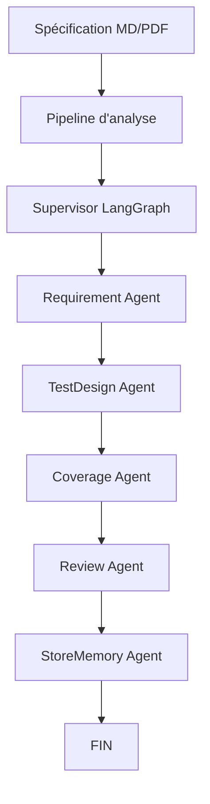

# 🧪 Agent Tests Generator — Value IT

Agent IA de génération de cas de tests QA à partir d'une spécification fonctionnelle (Markdown ou PDF), avec workflow multi-agents **LangGraph**. Génère des cas nominaux, cas limites et cas d'erreur avec traçabilité REQ / RG / EX.

## 📸 Aperçu

| Dashboard Angular | Architecture multi-agents | Rapport de validation |
|-------------------|---------------------------|----------------------|
|  |  |  |

> 👉 Ajoute tes captures d'écran dans le dossier `screens/` pour illustrer la vitrine.

---

## 🏗️ Architecture

Le workflow est orchestré par un **graphe LangGraph** déterministe :



**Flux d'exécution :**
1. **Pipeline d'analyse** — Reader → Cleaner → Chunking → SpecAnalyzer → SpecParser
2. **Supervisor** — Orchestration et routage déterministe (pas d'appel LLM)
3. **Requirement Agent** — Extraction des exigences fonctionnelles
4. **TestDesign Agent** — Conception des scénarios de tests
5. **Coverage Agent** — Vérification de la couverture des exigences
6. **Review Agent** — Revue qualité des cas générés
7. **StoreMemory Agent** — Persistance (stub)

---

## 🤖 Agents implémentés (`src/agents/`)

| Agent | Fichier | Rôle | Modèle LLM | Statut |
|-------|---------|------|------------|--------|
| Supervisor | `supervisor.py` | Orchestration et routage déterministe | — | ✅ Actif |
| Requirement | `requirement.py` | Extraction des exigences fonctionnelles | qwen/qwen3.6-35b-a3b | ✅ Actif |
| TestDesign | `test_design.py` | Cas nominaux, limites, erreurs | qwen/qwen3.6-35b-a3b | ✅ Actif |
| Coverage | `coverage.py` | Couverture des exigences | qwen/qwen3.6-35b-a3b | ✅ Actif |
| Review | `review.py` | Revue qualité | google/gemma-4-26b-a4b | ✅ Actif |
| StoreMemory | `store_memory.py` | Persistance en mémoire | — | ⚠️ Stub |

### Infrastructure partagée

- `base.py` — Classe de base `AgentBase`
- `executor.py` — Exécution LLM avec retry/backoff
- `router.py` — Routage des modèles par type de tâche
- `registry.py` — Registre des agents par `NodeType`
- `node_executor.py` — Exécution d'un nœud LangGraph avec traçage

---

## 📁 Structure du dépôt (vitrine)

```text
agent-tests-generator/
├── README.md                 # Ce fichier
├── ARCHITECTURE.md           # Guide d'architecture détaillé
├── ROADMAP.md                # Feuille de route
├── LICENSE                   # Licence MIT
├── .env.example              # Exemple de configuration
├── pyproject.toml            # Dépendances Python (Poetry)
├── .gitignore                # Fichiers exclus du dépôt
├── screens/                  # Captures d'écran de la vitrine
│   ├── dashboard-home.png
│   ├── agents-page.png
│   └── rapport-validation.png
├── docs/                     # Documentation complémentaire
└── src/
    ├── agents/               # 6 agents LangGraph + infrastructure
    ├── graph/                # StateGraph + conditions de routage
    ├── models/               # Modèles Pydantic / dataclasses
    ├── llm/                  # Client LLM, settings, exceptions
    └── prompts/              # Prompts des agents
```

---

## 🚀 Installation rapide

```bash
# Cloner le dépôt
git clone https://github.com/aymenichqa/agent-tests-generator.git
cd agent-tests-generator

# Installer les dépendances
poetry install

# Configurer l'environnement
cp .env.example .env
# Éditer .env avec ta clé API LLM

# Lancer l'API
poetry run uvicorn src.api.main:app --reload --port 8000

# Lancer le dashboard Angular (dans un autre terminal)
cd frontend
npm start
```

**URLs :**
- API : `http://127.0.0.1:8000`
- Healthcheck : `http://127.0.0.1:8000/api/health`
- Dashboard : `http://localhost:4200`

---

## 🗺️ Roadmap

Voir `ROADMAP.md` pour les phases prévues (RAG, API complète, dashboard Angular, multi-provider LLM, etc.).

---

## 🛠️ Technologies

- **Python 3.13+** — Backend et agents
- **Poetry** — Gestion des dépendances
- **LangChain / LangGraph** — Workflow multi-agents
- **FastAPI** — API REST
- **Pydantic** — Validation de données
- **Angular 18** — Dashboard frontend
- **SQLite** — Persistance locale

---

## 📄 Licence

Ce projet est sous licence [MIT](LICENSE).

---

Construit avec ❤️ par **Aymen Ichqarrane** — [Value IT](https://www.valueit.ma)